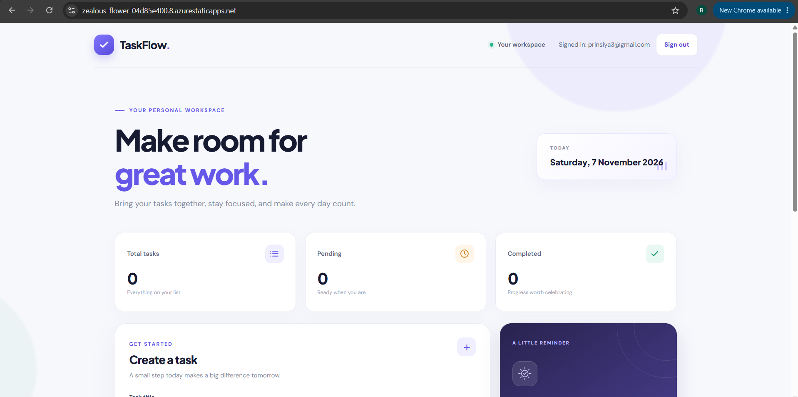
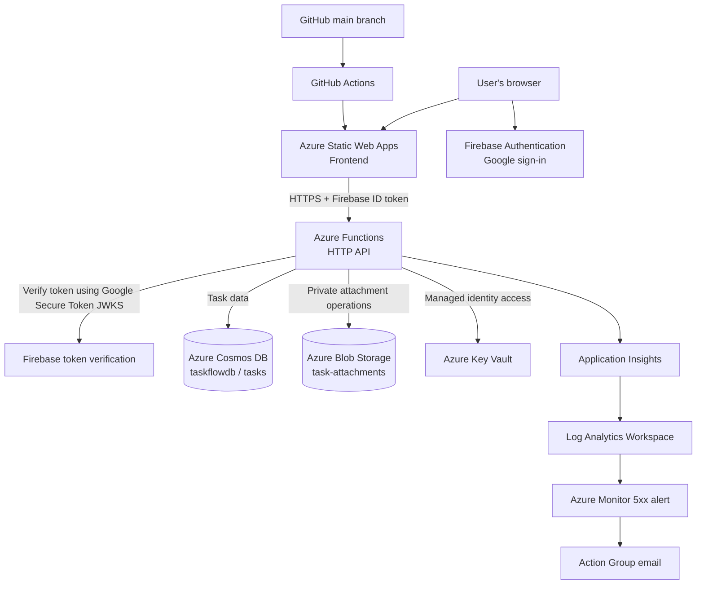

# TaskFlow — Serverless Task Manager on Microsoft Azure

TaskFlow is a cloud-hosted task management application built with a JavaScript frontend and a serverless API on Microsoft Azure. It supports Google sign-in, user-scoped task management, and private file attachments.

**Project status:** Deployed to Azure and manually tested in production for authentication, task CRUD, refresh persistence, task counters, and attachment upload, download, and deletion.

## Live Application

- **Web app:** https://zealous-flower-04d85e400.8.azurestaticapps.net
- **GitHub repository:** https://github.com/rinsiyap/azure-serverless-task-manager
- **Deployment:** GitHub Actions deploys frontend changes pushed to the `main` branch.

## Application Screenshot



*TaskFlow application dashboard.*

## Features

- Google authentication through Firebase Authentication.
- Backend verification of Firebase ID tokens.
- Create, list, edit, complete, and delete tasks.
- User-scoped task access using authenticated Firebase UIDs.
- Task ownership validation for API operations.
- Upload, download, and delete task attachments.
- Private Azure Blob Storage container with public blob access disabled.
- Serverless HTTP API using Azure Functions.
- Persistent task data in Azure Cosmos DB.
- HTTPS-only Azure hosting.
- Application telemetry and HTTP 5xx alerting.
- GitHub Actions CI/CD workflow.

## Architecture



## Azure Services

| Area | Service | Purpose |
|---|---|---|
| Frontend hosting | Azure Static Web Apps | Hosts the web application over HTTPS |
| API | Azure Functions (Flex Consumption) | Runs serverless HTTP endpoints |
| Database | Azure Cosmos DB | Stores task records |
| File storage | Azure Blob Storage | Stores private task attachments |
| Authentication | Firebase Authentication | Google sign-in and user identity |
| Token verification | Google Secure Token JWKS + `jose` | Verifies Firebase ID tokens in the API |
| Secrets | Azure Key Vault | Centralized secret storage and managed-identity access |
| Workload identity | Azure Managed Identity | Enables supported Azure resource access without embedding credentials |
| Monitoring | Application Insights | Application telemetry |
| Logs | Log Analytics | Centralized monitoring workspace |
| Alerting | Azure Monitor + Action Group | Notifies on configured HTTP 5xx conditions |
| CI/CD | GitHub Actions | Automates frontend deployment from GitHub |
| Infrastructure reference | Bicep | Documents references to deployed Azure resources |

**Infrastructure note:** `infra/main.bicep` is a reference/inventory template for existing resources. It is not a complete infrastructure-recreation template.

## Production Validation

The following were manually tested on the deployed application:

| Test | Result |
|---|---|
| Google sign-in | Passed |
| Create and list tasks | Passed |
| Data remains after page refresh | Passed |
| Edit task description | Passed |
| Mark task completed | Passed |
| Delete task | Passed |
| Task counters update | Passed |
| Upload an attachment smaller than 5 MB | Passed |
| Download and open an attachment | Passed |
| Delete an attachment | Passed |

These are manual functional checks, not a claim of a formal penetration test, load test, or independent security audit.

## Repository Structure

```text
azure-serverless-task-manager/
├── api/
│   ├── src/
│   │   └── functions/
│   │       ├── auth.js
│   │       ├── TasksApi.js
│   │       └── AttachmentsApi.js
│   ├── package.json
│   └── package-lock.json
├── frontend/
│   ├── app.js
│   ├── firebase.js
│   ├── index.html
│   └── style.css
├── infra/
│   └── main.bicep
├── docs/
│   ├── architecture.mmd
│   ├── deployment.md
│   └── security.md
└── screenshots/
    └── dashboard.png
```

## Local Development

### Prerequisites

- Node.js compatible with the API package configuration.
- Azure Functions Core Tools.
- Azure CLI.
- Git.
- A Firebase project with Google sign-in enabled.
- Local Azure settings and resource configuration.

### Frontend

From the repository root:

```powershell
npx http-server .\frontend -p 8080 -c-1
```

Open http://localhost:8080.

### API and Local Storage Emulator

Start Azurite in one terminal:

```powershell
cd .\api
npx azurite --silent --location .\.azurite
```

Start the Functions host in another terminal:

```powershell
cd .\api
func start --cors http://localhost:8080
```

Use the project's local `api/local.settings.json` for development-only settings. This file must remain local and must never be committed.

## Deployment

Push reviewed changes to `main`. The GitHub Actions workflow deploys the frontend to Azure Static Web Apps.

API deployment is handled through the configured Azure Functions deployment process. Confirm the relevant deployment procedure before assuming an API change has reached production.

See [Deployment Guide](docs/deployment.md).

## Security

- The API requires a Firebase bearer token and verifies its signature, issuer, audience, and subject.
- Task and attachment operations are scoped to the authenticated user.
- Attachments are stored in a private Blob Storage container.
- Azure Functions uses managed identity for configured Azure resource access.
- HTTPS is enforced for deployed application resources.
- Local settings, secrets, and connection strings must not be committed.
- Firebase web configuration is client-side configuration; it does not replace backend authorization.

See [Security Notes](docs/security.md).

## Cost Considerations

Azure for Students and free-tier eligibility can reduce costs, but they do not guarantee that every resource or usage pattern is free.

Cosmos DB Free Tier has eligibility and account-availability conditions. Monitor actual usage, budgets, storage, telemetry ingestion, and any resources outside free allowances. Delete resources when they are no longer needed.

## Screenshots

The repository currently includes the main application dashboard:

- `screenshots/dashboard.png` — signed-in TaskFlow dashboard.

Additional screenshots of task management, attachments, Azure resources, and GitHub Actions deployments can be added later.

Do not include access tokens, API keys, connection strings, personal email addresses, or other sensitive information in screenshots.

## Author

Built as a cloud engineering portfolio project to demonstrate serverless application development, cloud storage, identity integration, monitoring, and CI/CD on Microsoft Azure.